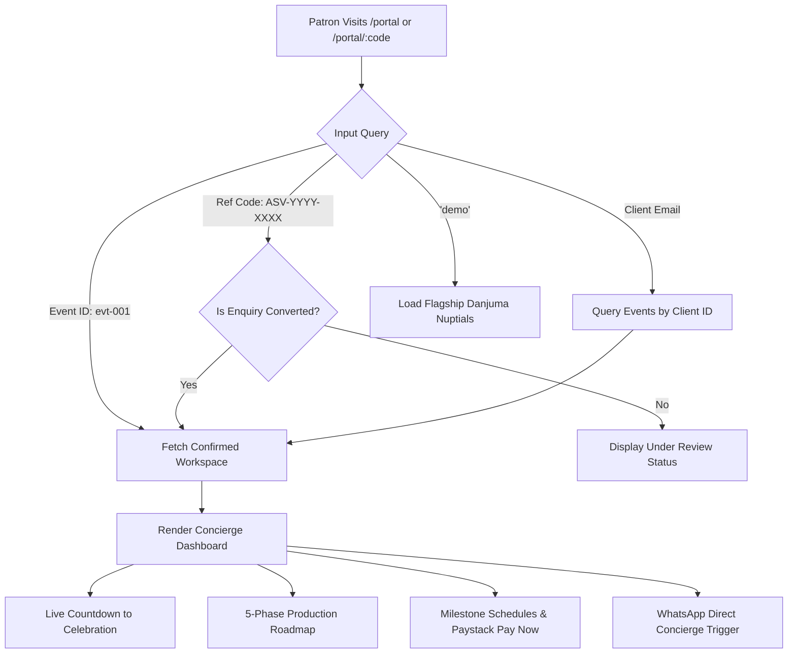

# Phase 7 — Enterprise Scaling, Luxury Client Experience & Invoicing

## 1. Executive Summary

Phase 7 completes the transition of **ASEVA** from an internal planning tool into an enterprise-grade luxury event management and patron concierge ecosystem. This phase bridges the operational dashboard and the high-net-worth patron by delivering:

1. **Patron Self-Service Concierge Portal** (`/portal`, `/portal/:code`): An unauthenticated, security-keyed client portal giving patrons real-time visibility into their celebration's countdown, 5-phase spatial production roadmap, itemized financial schedules, and instant Paystack settlement.
2. **Branded Printable Luxury Invoice & Contract Generator** (`/dashboard/events/:id/invoice`): A print-optimized document engine (`@media print`) rendering itemized milestone deliverables, verified payment references, Nigerian corporate bank transfer narration, and an official gold seal.
3. **Immutable System Audit Logging Ledger**: An operational activity ledger tracking lead conversions, payment recordings, and expense entries with timestamps (`WAT`) and staff actors, reviewable directly within Dashboard Settings.
4. **Automated Client Notification Templates** (`notificationService.js`): Branded transactional communication templates for booking acknowledgements, formal proposals, and milestone due date alerts with direct WhatsApp concierge escalation.

---

## 2. Patron Self-Service Concierge Portal

### 2.1 Route & Lookup Mechanics
- **Routes**: `/portal` (interactive lookup search) and `/portal/:code` (direct deep-link via proposal emails or SMS).
- **Lookup Support**:
  - Event ID (`evt-001`)
  - Unique Booking Reference Code (`ASV-2026-1042`)
  - Client Email Address (`mansur@danjumagroup.com`)
  - Direct Flagship Demo keyword (`demo` or `/portal/demo`)

### 2.2 Financial & Milestone Slices (Integer Kobo)
All financials displayed in the client portal adhere strictly to the Nigerian Naira integer kobo architecture (`BIGINT` representation):
- **Contract Value**: Total agreed budget in integer kobo.
- **Verified Settled**: Sum of all confirmed payment records in integer kobo.
- **Outstanding Balance**: `AgreedPriceKobo - TotalPaidKobo`.
- **Milestone Tranches**: Individual 30% Retainer, 40% Mid-Planning, and 30% Final Settlement records with due dates and live Paystack checkout integration.

### 2.3 5-Phase Spatial Production Roadmap
Patrons can track project milestones without contacting staff:
1. **Phase 01 — Spatial Concept & Floral Architecture**: Moodboards, 3D floral sketches, custom fabrication specs (`Completed`).
2. **Phase 02 — Venue 3D Spatial Layout & Guest Flow**: CAD layouts, red carpet ingress, VIP security positioning (`Completed`).
3. **Phase 03 — Culinary Curation & Table Styling**: 5-course private tasting, signature mixology, imported crystal styling (`Active Production`).
4. **Phase 04 — Technical AV Rig & Rehearsal Run-of-Show**: Curved LED calibration, orchestral sound check, VIP protocol (`T-7 Days`).
5. **Phase 05 — Execution & Seamless Day-of Orchestration**: Executive on-site direction from dawn setup to late-night departure (`Event Day`).

---

## 3. Printable Luxury Invoice & Contract Summary

### 3.1 Styling & Print Optimization
Accessible at `/dashboard/events/:id/invoice`, the invoice generator features:
- **Typography**: Cormorant Garamond / Playfair Display paired with Inter for high-fashion editorial prestige.
- **Print Media Queries (`@media print`)**:
  - Hides non-printable UI chrome (`navbar`, `sidebar`, print buttons, back links).
  - Enforces `A4` page size with 15mm margins and zero box-shadows.
  - Ensures clean black-and-gold high-contrast borders for physical luxury paper output.
  - Controls page breaks so milestone tables and signatures do not clip awkwardly.

### 3.2 Document Anatomy
- **Header**: Official ASEVA monogram, Lagos Island registered office address, and contact lines.
- **Metadata Grid**: Invoice reference (`INV-2026-XXXX`), issue date, celebration date, guest count, and venue address.
- **Bill-To Entity**: Full client legal name, corporate affiliation, and verified contact info.
- **Itemized Deliverable Breakdown**: 3-tranche milestone breakdown with kobo calculations, status badges, and transaction references for cleared payments.
- **Bank Transfer Narration**: Dedicated treasury instructions with Access Bank / Zenith Bank corporate account details and reference matching instructions.
- **Legal Seal & Signatures**: Dual signature blocks for Executive Creative Director and Authorized Patron Representative alongside official SVG gold seal.

---

## 4. Immutable System Audit Logging

### 4.1 Ledger Architecture
All high-stakes financial, operational, and lifecycle actions are recorded automatically into the immutable audit trail:
- **`enquiry_converted`**: Fired when a prospective enquiry is accepted, creating a client profile, event project workspace, and milestone schedule.
- **`payment_recorded`**: Fired whenever a manual bank transfer or Paystack payment is confirmed, noting transaction reference, actor, and verified amount.
- **`expense_logged`**: Fired when operational vendor disbursements (florals, AV, catering) are logged.
- **`security_override` / `status_changed`**: Fired on state transitions or permission elevation.

### 4.2 Dashboard Settings View
Staff can inspect the audit ledger under **Dashboard → Settings → Audit Trail Ledger**, featuring:
- Live searchable and filterable list of all logged events.
- Actor name (e.g., `Folashade Adeleke (Lead Director)`).
- Visual action category badges (`CONVERT ENQUIRY`, `PAYMENT RECORDED`, `EXPENSE LOGGED`).
- Formatted West Africa Time (`WAT`) timestamps.

---

## 5. Client Notification Engine

The `notificationService.js` engine powers branded communications:

| Notification Type | Trigger Event | Channel | Key Payload |
|---|---|---|---|
| **Enquiry Acknowledgement** | Client submits consultation form | Email | Reference code (`ASV-YYYY-XXXX`), target date, 24-48 hr response SLA. |
| **Quotation Proposal** | Enquiry converted to workspace | Email | Agreed fee in NGN, direct link to Patron Portal (`/portal/:code`). |
| **Milestone Reminder** | T-14 and T-3 days to payment due date | Email | Milestone name, installment amount in NGN, due date, payment link. |
| **Concierge WhatsApp Trigger** | Client portal direct action | WhatsApp | Pre-filled deep link targeting Lead Concierge phone number. |

---

## 6. Verification & Quality Gates

| Verification Gate | Result | Notes |
|---|---|---|
| **Vitest Test Suite** | **33/33 Tests Passing (100%)** | 8 test files covering kobo, rbac, enquiry, sync, paystack, conversion, portal, and audit. |
| **Production Vite Build** | **Success (Exit Code 0)** | Zero oversized chunk warnings; clean code-splitting into vendor chunks. |
| **Client Portal Lookup** | **Verified** | Successful lookup by ID, enquiry reference, email, and `'demo'` fallback. |
| **Invoice Print View** | **Verified** | Formatted for physical print (`window.print()`) with print stylesheets. |
| **Audit Ledger View** | **Verified** | Live on Dashboard Settings under the "Audit Trail" tab. |
